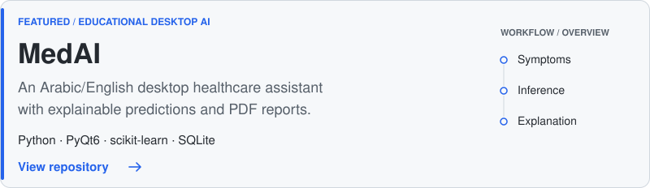
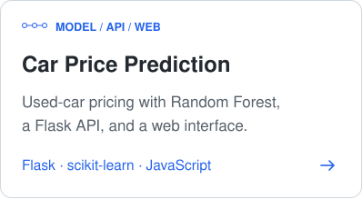
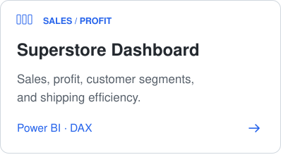
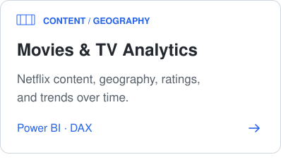
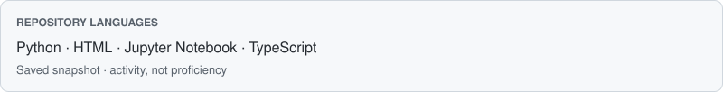

<h1>
  <picture>
    <source media="(prefers-color-scheme: dark)" srcset="./assets/portfolio/monogram-dark.svg">
    
  </picture>
  Hussein Zahran
</h1>

**Python developer · Artificial Intelligence student**

## Software that makes complex ideas useful.

I'm an Artificial Intelligence student at **Al-Zaytoonah University of Jordan**, building practical Python software. My interests span software engineering, explainable machine learning, predictive modeling, and data analytics.

[GitHub](https://github.com/HusseinZahran-1) &nbsp; / &nbsp; [LinkedIn](https://www.linkedin.com/in/hussein-zahran-911481358/)

## Selected work

<a href="https://github.com/HusseinZahran-1/MedAI-Intelligent-Healthcare-Assistant">
  <picture>
    <source media="(max-width: 600px) and (prefers-color-scheme: dark)" srcset="./assets/portfolio/medai-mobile-dark.svg">
    <source media="(max-width: 600px)" srcset="./assets/portfolio/medai-mobile-light.svg">
    <source media="(prefers-color-scheme: dark)" srcset="./assets/portfolio/medai-desktop-dark.svg">
    
  </picture>
</a>

  <a href="https://github.com/HusseinZahran-1/car_price_prediction">
  <picture>
    <source media="(max-width: 600px) and (prefers-color-scheme: dark)" srcset="./assets/portfolio/car-price-mobile-dark.svg">
    <source media="(max-width: 600px)" srcset="./assets/portfolio/car-price-mobile-light.svg">
    <source media="(prefers-color-scheme: dark)" srcset="./assets/portfolio/car-price-desktop-dark.svg">
    
  </picture>
  </a>
  <a href="https://github.com/HusseinZahran-1/Superstore_Sales_Dashboard">
  <picture>
    <source media="(max-width: 600px) and (prefers-color-scheme: dark)" srcset="./assets/portfolio/superstore-mobile-dark.svg">
    <source media="(max-width: 600px)" srcset="./assets/portfolio/superstore-mobile-light.svg">
    <source media="(prefers-color-scheme: dark)" srcset="./assets/portfolio/superstore-desktop-dark.svg">
    
  </picture>
  </a>
  <a href="https://github.com/HusseinZahran-1/Movies-TV-Shows-Analytics-Dashboard">
  <picture>
    <source media="(max-width: 600px) and (prefers-color-scheme: dark)" srcset="./assets/portfolio/movies-tv-mobile-dark.svg">
    <source media="(max-width: 600px)" srcset="./assets/portfolio/movies-tv-mobile-light.svg">
    <source media="(prefers-color-scheme: dark)" srcset="./assets/portfolio/movies-tv-desktop-dark.svg">
    
  </picture>
  </a>

[Browse all repositories →](https://github.com/HusseinZahran-1?tab=repositories)

## Working toolkit

  <picture>
    <source media="(prefers-color-scheme: dark)" srcset="./assets/portfolio/icon-languages-dark.svg">
    
  </picture>
  <strong>Languages &amp; web</strong> 
  Python · Java · JavaScript · HTML · CSS

  <picture>
    <source media="(prefers-color-scheme: dark)" srcset="./assets/portfolio/icon-applications-dark.svg">
    
  </picture>
  <strong>Backend &amp; desktop</strong> 
  FastAPI · Flask · PyQt6 · SQLite

  <picture>
    <source media="(prefers-color-scheme: dark)" srcset="./assets/portfolio/icon-machine-learning-dark.svg">
    
  </picture>
  <strong>AI &amp; machine learning</strong> 
  scikit-learn · PyTorch · TensorFlow · OpenCV

  <picture>
    <source media="(prefers-color-scheme: dark)" srcset="./assets/portfolio/icon-analytics-dark.svg">
    
  </picture>
  <strong>Data &amp; analytics</strong> 
  Pandas · NumPy · Power BI · DAX

  <picture>
    <source media="(prefers-color-scheme: dark)" srcset="./assets/portfolio/icon-tools-dark.svg">
    
  </picture>
  <strong>Developer tools</strong> 
  Git · GitHub · VS Code · Postman

This toolkit includes technologies I use and actively explore. Each project uses a different subset.

## On GitHub

<a href="./profile-summary-card-output/github_dark/1-repos-per-language.svg">
  <picture>
    <source media="(max-width: 600px) and (prefers-color-scheme: dark)" srcset="./assets/portfolio/activity-mobile-dark.svg">
    <source media="(max-width: 600px)" srcset="./assets/portfolio/activity-mobile-light.svg">
    <source media="(prefers-color-scheme: dark)" srcset="./assets/portfolio/activity-desktop-dark.svg">
    
  </picture>
</a>

[Current contributions](https://github.com/HusseinZahran-1) &nbsp; / &nbsp; [Repository language snapshot](./profile-summary-card-output/github_dark/1-repos-per-language.svg) &nbsp; / &nbsp; [Commit language snapshot](./profile-summary-card-output/github_dark/2-most-commit-language.svg)

---

Interested in practical AI, Python applications, or data-driven products? [Connect on LinkedIn](https://www.linkedin.com/in/hussein-zahran-911481358/).
