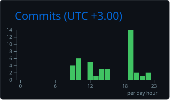

👨‍💻 About Me
I'm Hussein Zahran, an Artificial Intelligence student at Al-Zaytoonah University of Jordan and a Python developer who enjoys turning complex ideas into useful software.

I work on projects across machine learning, explainable AI, predictive modeling, desktop applications, APIs, and data analytics. I care about clean architecture, thoughtful interfaces, and solutions that make sense beyond the notebook.
- 🧠 Interests: Applied AI, machine learning, explainability, and intelligent systems
- 🐍 Development: Python applications, backend APIs, and data-driven tools
- 📊 Analytics: Turning raw data into useful visual insights
- 🎯 Focus: Building end-to-end projects with maintainable, well-documented code
My philosophy: Build with purpose. Keep it simple. Improve every day.

🧰 Tech Stack

Languages
Frameworks & Application Development
AI, Data & Analytics

Tools & Workflow

Some tools shown above represent technologies I'm exploring or expanding my experience with, not necessarily technologies used in every featured project.
🚀 Featured Projects
<table>
<tr>
<td width="50%" valign="top">🏥 MedAI — Intelligent Healthcare Assistant
An educational desktop decision-support application with symptom-based predictions, explainable results, risk guidance, and bilingual PDF reporting.

Highlights: Explainable predictions · Desktop UI · PDF reports

Stack: Python PyQt6 scikit-learn SQLite

Explore project →
</td>
<td width="50%" valign="top">🚗 Car Price Prediction
A full-stack application that estimates used-car prices using a Random Forest model, a Flask API, and an interactive web interface.

Highlights: Predictive modeling · REST API · Web UI

Stack: Python Flask scikit-learn HTML/CSS/JS

Explore project →
</td>
</tr>
<tr>
<td width="50%" valign="top">📊 Superstore Sales Dashboard
An interactive Power BI dashboard for understanding sales performance, profit trends, customer behavior, and shipping efficiency.

Highlights: Business insights · Interactive reports · Data storytelling

Stack: Power BI Analytics Visualization

Explore project →
</td>
<td width="50%" valign="top">🗂️ More Projects
Explore additional work in data analytics, machine learning, and software development, including my Movies & TV Shows analytics dashboard.

Focus: Applied AI · Data tools · Interactive applications

Browse repositories →
</td>
</tr>
</table>📈 GitHub Activity

<!-- Generated and committed by .github/workflows/github-stats.yml -->

Cards are generated by GitHub Actions and stored in this repository. They will appear after the first successful workflow run.

🎯 What I'm Working Toward
- Stronger AI foundations: Deepening my understanding of machine learning and intelligent systems.
- Better backend engineering: Designing clean APIs and learning more about FastAPI and scalable application architecture.
- End-to-end delivery: Taking projects from data exploration to usable applications.
- Engineering quality: Improving testing, documentation, and maintainability.
🤝 Let's Connect

Interested in AI, practical software, or data-driven products?

I'm always open to exchanging ideas and learning from other developers.

Build with purpose · Keep learning · Make it useful

