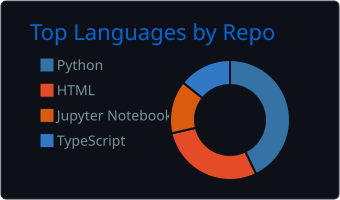
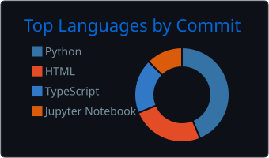

# Hi, I'm Hussein Zahran

**Python Developer · Artificial Intelligence Student**

I turn complex ideas into useful software, from machine learning models to desktop applications and APIs. I'm interested in bringing practical AI and thoughtful software engineering together.

## About Me

- Studying **Artificial Intelligence at Al-Zaytoonah University of Jordan**.
- Interested in applied AI, explainable machine learning, predictive modeling, and data analytics.
- Building desktop applications, backend APIs, and tools that turn data into useful insights.
- Developing my foundations in AI and backend engineering, with a focus on clean architecture, testing, documentation, and maintainability.

> Build with purpose. Keep it simple. Improve every day.

## Tech Stack

- **Languages & web:** Python, Java, JavaScript, HTML, CSS
- **Backend & desktop:** FastAPI, Flask, PyQt6, SQLite
- **AI & machine learning:** scikit-learn, PyTorch, TensorFlow, OpenCV
- **Data & analytics:** Pandas, NumPy, Power BI, DAX
- **Development tools:** Git, GitHub, VS Code, Postman

Some of these technologies are ones I'm actively exploring; they aren't all used in every featured project.

## Featured Projects

### MedAI

An educational healthcare decision-support desktop application with symptom-based predictions, explainable results, risk guidance, an Arabic/English interface, and PDF reports.

**Tech:** Python, PyQt6, scikit-learn, SQLite

[View repository](https://github.com/HusseinZahran-1/MedAI-Intelligent-Healthcare-Assistant)

### Car Price Prediction

A full-stack application that estimates used-car prices using a Random Forest model, a Flask API, and an interactive web interface.

**Tech:** Python, Flask, scikit-learn, JavaScript

[View repository](https://github.com/HusseinZahran-1/car_price_prediction)

### Superstore Dashboard

An interactive Power BI dashboard exploring sales performance, profit trends, customer behavior, and shipping efficiency.

**Tech:** Power BI, DAX

[View repository](https://github.com/HusseinZahran-1/Superstore_Sales_Dashboard)

More data visualization: [Movies & TV Shows Analytics Dashboard](https://github.com/HusseinZahran-1/Movies-TV-Shows-Analytics-Dashboard).

Browse [all my repositories](https://github.com/HusseinZahran-1?tab=repositories).

## GitHub Stats

A snapshot of languages across my repositories and commits. These charts reflect activity, may lag behind recent changes, and do not measure proficiency.

[View my GitHub profile and contributions](https://github.com/HusseinZahran-1)

## Connect With Me

Interested in AI, practical software, or data-driven products? I'm open to exchanging ideas and learning from other developers.

- [LinkedIn](https://www.linkedin.com/in/hussein-zahran-911481358/)
- [GitHub](https://github.com/HusseinZahran-1)

---

Thanks for visiting. **Build with purpose. Keep learning. Make it useful.**
