## 👨‍💻 About Me

I'm **Hussein Zahran**, an Artificial Intelligence student at **Al-Zaytoonah University of Jordan** and a Python developer who turns complex ideas into useful software.

My work spans machine learning, explainable AI, predictive modeling, desktop applications, APIs and data analytics. I care about clean architecture, thoughtful interfaces, and solutions that hold up beyond the notebook.

| | |
|---|---|
| 🧠 **Interests** | Applied AI, machine learning, explainability, intelligent systems |
| 🐍 **Development** | Python applications, backend APIs, data-driven tools |
| 📊 **Analytics** | Turning raw data into clear visual insight |
| 🎯 **Focus** | End-to-end projects with maintainable, well-documented code |

> **Build with purpose. Keep it simple. Improve every day.**

## 🧰 Tech Stack

**Languages** 

**Frameworks & Application Development** 

**AI, Data & Analytics** 
 

**Tools & Workflow** 

Some technologies shown are ones I'm actively exploring, not necessarily used in every featured project.

## 🚀 Featured Projects

<table>
<tr>
<td width="50%" valign="top">

### 🏥 MedAI — Healthcare Assistant
An educational desktop decision-support app with symptom-based predictions, explainable results, risk guidance and bilingual PDF reporting.

**Highlights:** Explainable predictions · Desktop UI · PDF reports

[**Explore project →**](https://github.com/HusseinZahran-1?tab=repositories&q=medai)

</td>
<td width="50%" valign="top">

### 🚗 Car Price Prediction
A full-stack app that estimates used-car prices with a Random Forest model, a Flask API and an interactive web interface.

**Highlights:** Predictive modeling · REST API · Web UI

[**Explore project →**](https://github.com/HusseinZahran-1?tab=repositories&q=car)

</td>
</tr>
<tr>
<td width="50%" valign="top">

### 📊 Superstore Sales Dashboard
An interactive Power BI dashboard covering sales performance, profit trends, customer behavior and shipping efficiency.

**Highlights:** Business insights · Interactive reports · Data storytelling

[**Explore project →**](https://github.com/HusseinZahran-1?tab=repositories&q=superstore)

</td>
<td width="50%" valign="top">

### 🗂️ More Projects
Additional work in data analytics, machine learning and software development, including a Movies & TV Shows analytics dashboard.

**Focus:** Applied AI · Data tools · Interactive applications

[**Browse all repositories →**](https://github.com/HusseinZahran-1?tab=repositories)

</td>
</tr>
</table>

## 📈 GitHub Activity

## 🎯 What I'm Working Toward

- **Stronger AI foundations** — deepening my grasp of machine learning and intelligent systems.
- **Better backend engineering** — clean APIs, FastAPI and scalable architecture.
- **End-to-end delivery** — taking projects from data exploration to usable applications.
- **Engineering quality** — testing, documentation and maintainability.

## 🤝 Let's Connect

Interested in AI, practical software or data-driven products? I'm always open to exchanging ideas and learning from other developers.

**Build with purpose · Keep learning · Make it useful**

