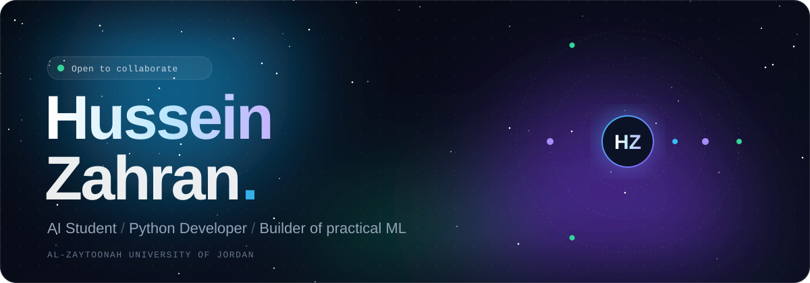
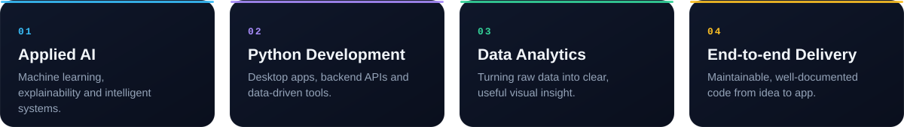
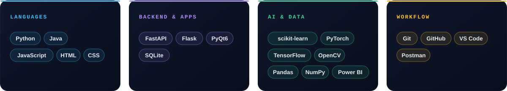
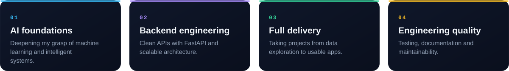

 

I'm **Hussein Zahran**, an Artificial Intelligence student at **Al-Zaytoonah University of Jordan** and a Python developer who turns complex ideas into useful software. My work spans machine learning, explainable AI, predictive modeling, desktop applications, APIs and data analytics, and I care about clean architecture and solutions that hold up beyond the notebook.

> **Build with purpose. Keep it simple. Improve every day.**

 

Some technologies shown are ones I'm actively exploring, not necessarily used in every featured project.

 

<table>
<tr>
<td width="50%">

</td>
<td width="50%">

</td>
</tr>
<tr>
<td width="50%">

</td>
<td width="50%">

</td>
</tr>
</table>

 

 

Interested in AI, practical software or data-driven products? I'm always open to exchanging ideas and learning from other developers.

&nbsp;&nbsp;

 

