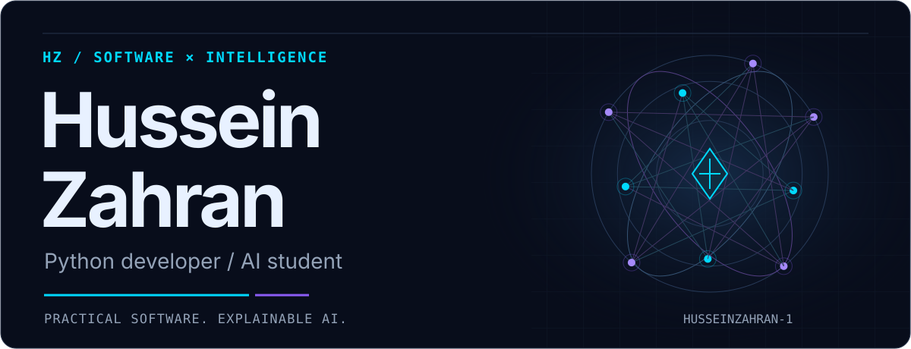
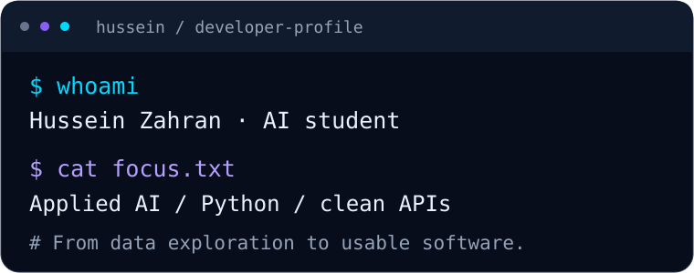
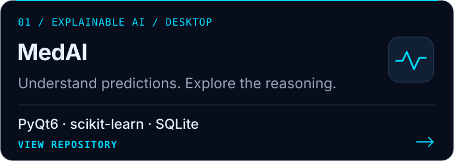
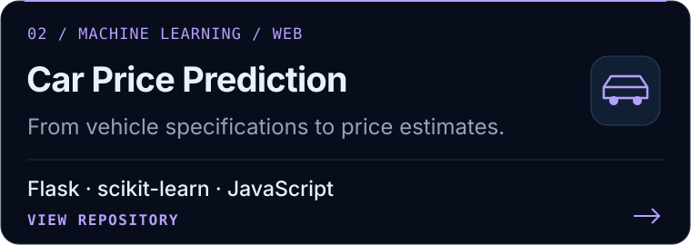
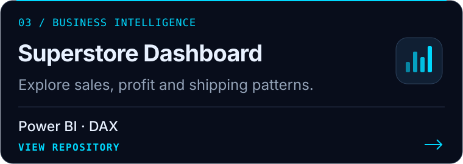
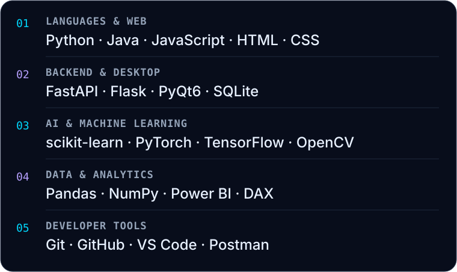

<picture>
  <source media="(max-width: 600px)" srcset="./assets/hero-banner-mobile.svg">
  
</picture>

## About Me

I'm **Hussein Zahran**, an Artificial Intelligence student at **Al-Zaytoonah University of Jordan** and a Python developer interested in software engineering and applied AI. I build desktop applications, APIs, and analytical tools that make complex ideas useful.

My interests include **explainable machine learning**, predictive modeling, and data analytics. I'm developing my foundations in backend engineering, clean architecture, testing, and documentation.

## Developer Snapshot

<picture>
  <source media="(max-width: 600px)" srcset="./assets/developer-terminal-mobile.svg">
  
</picture>

## Featured Projects

**[MedAI](https://github.com/HusseinZahran-1/MedAI-Intelligent-Healthcare-Assistant)** brings symptom-based predictions, explainable results, risk guidance, and PDF reports into an Arabic/English desktop interface. An educational decision-support project.

**[Car Price Prediction](https://github.com/HusseinZahran-1/car_price_prediction)** connects a Random Forest model to a Flask API and an interactive web interface for estimating used-car prices.

**[Superstore Dashboard](https://github.com/HusseinZahran-1/Superstore_Sales_Dashboard)** explores sales performance, profit trends, customer segments, and shipping efficiency through interactive Power BI reports.

More data visualization: **[Movies & TV Shows Analytics Dashboard](https://github.com/HusseinZahran-1/Movies-TV-Shows-Analytics-Dashboard)**. Browse [all repositories](https://github.com/HusseinZahran-1?tab=repositories).

## Technology Stack

<picture>
  <source media="(max-width: 600px)" srcset="./assets/technology-stack-mobile.svg">
  
</picture>

Some technologies are part of my ongoing learning. This toolkit is not a proficiency ranking, and each project uses a different subset.

View the technology stack as text

- **Languages & web:** Python, Java, JavaScript, HTML, CSS
- **Backend & desktop:** FastAPI, Flask, PyQt6, SQLite
- **AI & machine learning:** scikit-learn, PyTorch, TensorFlow, OpenCV
- **Data & analytics:** Pandas, NumPy, Power BI, DAX
- **Development tools:** Git, GitHub, VS Code, Postman

## GitHub Activity

These locally stored language charts are activity snapshots and may lag behind recent changes. Repository languages and commit languages do not measure expertise.

  
  

[Explore current repositories and contributions on GitHub](https://github.com/HusseinZahran-1).

## Connect With Me

Interested in practical AI, Python applications, or data-driven products? Let's exchange ideas and learn from each other's work.

**[LinkedIn](https://www.linkedin.com/in/hussein-zahran-911481358/)** &nbsp; / &nbsp; **[GitHub](https://github.com/HusseinZahran-1)**

